# Optional app only newsletter setup

This is an optional alternative that requires additional administrator grants. The normal setup reuses the existing authorized Azure connectors; follow [the current setup guide](newsletter-publishing.md).

Prof. Kornhauser continues sending his newsletter to **smartdrivingcars@princeton.edu**. After the administrator setup below, a read-only reconciliation job discovers the Listserv delivery in the newsletter mailbox, renders a safe web edition, commits it, deploys GitHub Pages, and verifies the public issue. The professor needs no GitHub, Azure, Resend, or Healthchecks account.

The replacement is implemented in this repository and **disabled until its identity and mailbox permissions are configured**. The latest supplied issue, **14.16 Bad Media dated October 22, 2026**, is published at [its permanent public URL](https://smartdrivingcar.com/14.16-badMedia-10.22.26/). Existing subscriptions and Listserv distribution remain the source of email delivery.

## Confirmed failures in the previous pipeline

Azure's October 22 run received a trigger body containing `value: [message]`. The Logic App lacked `splitOn`, read `triggerBody()['body']` from the enclosing object, and the Function returned HTTP 400 with `Missing body_html field`. The September 27 run also failed at processing. The template now splits the array and protects processor inputs and outputs in run history.

The receiver also committed using `GITHUB_TOKEN` and expected that push to start the Pages workflow. GitHub suppresses push-triggered workflow runs from that token. Every publishing entry point now invokes the shared deployment workflow directly. [GitHub documents this token behavior](https://docs.github.com/en/actions/how-tos/write-workflows/choose-when-workflows-run/trigger-a-workflow).

An arrival trigger cannot recover a message it already missed. Reconciliation scans retained mail regardless of its read flag or folder, which also removes dependence on an Outlook folder rule. It deliberately keeps the mail intact for recovery.

## Implemented pipeline

```mermaid
flowchart LR
  A[Professor sends to Listserv] --> B[Newsletter mailbox retains delivery]
  B --> C[GitHub scheduled reconciliation]
  C --> D[Validate author and Listserv delivery]
  D --> E[Sanitize and preserve newsletter structure]
  E --> F[Commit issue once]
  F --> G[Explicit Pages deployment]
  G --> H[Verify public URL and source fingerprint]
  H --> I[Optional Healthchecks and Resend status]
```



The schedule runs at minutes 7, 22, 37, and 52. A manual workflow run can recover immediately. The default lookback is 90 days; operators can extend it to 3650 days for recovery. The job follows Graph pagination, retries throttling and transient service errors, bounds message/response sizes and page counts, and rejects redirected API destinations before sending credentials. It never marks mail read, moves it, deletes it, or sends newsletter email.

The issue identifier and date come from the subject, such as `SmartDrivingCars_14.16-badMedia-10.22.26`. A strict identifier prevents path traversal. New issues contain a fingerprint of sanitized content. Duplicate deliveries do not overwrite posts; changed content with the same identifier fails for manual review. Legacy and manually imported issues are marked or treated as curated: they remain authoritative and are skipped without replacing them. This avoids treating Microsoft Graph HTML normalization as a revision of a manually imported edition. Version 1 parsing preserves headings, paragraphs, lists, tables, and emphasis; unwraps Outlook Safe Links; removes active content and per-recipient subscription tickets; and escapes Liquid syntax before Jekyll sees it. Images are represented by their alternative text; remote pixels and CID images are not fetched.

The workflow verifies each discovered public issue's identity and, for new-format issues, its source fingerprint. A committed issue whose deployment failed is retried on a later poll even though it is now a duplicate. No advancing mailbox cursor can hide an unpublished issue. All publishers share the same concurrency group and use normal pushes, with no automated history rewriting or force push. GitHub may replace a pending run under concurrency; reconciliation recovers from retained mail on the next run.

## Security model

Use a dedicated Entra application with GitHub OIDC federation restricted to the repository's `newsletter-mailbox` environment. Restrict that environment to `main`; allow automated jobs without a required reviewer after commissioning. The identity needs **Application Mail.Read scoped to only the newsletter mailbox through Exchange Application RBAC**. It needs no Azure subscription role, tenant-wide Graph Mail.Read grant, password, Mail.Send, or Mail.ReadWrite.

Exchange RBAC grants and Entra API grants are additive. Adding tenant-wide Entra Mail.Read would defeat the mailbox boundary. The administrator must check for that grant and test a real Graph request against a different mailbox, because Exchange's authorization test excludes separate Entra grants. [Microsoft explains mailbox scopes, additive grants, and authorization tests](https://learn.microsoft.com/en-us/exchange/permissions-exo/application-rbac).

The application accepts only the configured author, Listserv sender, list recipient, newsletter subject, and Princeton List-Help marker. These headers narrow processing; they do not cryptographically authenticate an email. Before enabling, Princeton administrators must confirm Listserv posting restrictions and authenticated transport/anti-spoofing controls for delivery into this mailbox. Avoid forwarding through a service that changes sender metadata. Keep this a dedicated processing mailbox so the scoped identity cannot read unrelated departmental correspondence.

Raw MIME messages, Graph identifiers, recipient headers, tokens, and private mailbox addresses are never committed or deliberately logged by the new pipeline. Public issue text is intended for publication. Operator notifications contain only workflow links and counts. GitHub workflow editors and `main` writers are trusted to deploy code; protect `main`, review workflow changes, and use CODEOWNERS or equivalent repository policy. Container tests run without network access. Pages builds fail if source emails or private pipeline directories appear in the site artifact.

## Administrator setup

### 1 Confirm mailbox and delivery policy

Confirm the actual mailbox UPN with its owner. Existing project documentation names `orfe-lists@princeton.edu`, but the workflow requires an explicit secret rather than assuming it. Ensure it subscribes to the SmartDrivingCars list and retains messages for at least 90 days. The replacement searches across folders, so no special folder rule is necessary.

Confirm the author is `alaink@princeton.edu`, the delivered Sender is `smartdrivingcars@princeton.edu`, and List-Help contains the Princeton SmartDrivingCars archive URL. Confirm the transport and list posting controls described above. Save a known delivery for commissioning.

### 2 Create the dedicated identity

On macOS with Azure CLI, GitHub CLI, and project Python available:

```zsh
python3 -m venv .venv
.venv/bin/python -m pip install -r requirements-dev.lock
az login --tenant YOUR_TENANT_ID
export NEWSLETTER_APP_NAME=smartdrivingcar-newsletter-publisher
export NEWSLETTER_GITHUB_REPOSITORY=PrincetonUniversity/smartdrivingcar
export NEWSLETTER_AZURE_TENANT_ID=YOUR_TENANT_ID
./azure/pipeline/deploy.zsh --dry-run
./azure/pipeline/deploy.zsh
```

The script creates or finds the dedicated named app and service principal and reconciles its named OIDC credential. Re-running `update.zsh` applies the same configuration. Record its client ID and **enterprise service principal object ID**. Use a new unique app name, never an identity shared with another application. OIDC avoids a stored application password. [GitHub's Azure OIDC guide](https://docs.github.com/en/actions/how-tos/secure-your-work/security-harden-deployments/oidc-in-azure) explains the trust relationship.

Create GitHub environment **newsletter-mailbox**, restrict deployment branches to `main`, and configure the secrets below. The exact federation subject is `repo:PrincetonUniversity/smartdrivingcar:environment:newsletter-mailbox`.

### 3 Grant and verify mailbox isolation

An Exchange administrator runs PowerShell 7 with the ExchangeOnlineManagement module and connects using `Connect-ExchangeOnline`. The included script supports `-WhatIf` and reuses its named scope/assignment:

```powershell
./azure/pipeline/configure-mailbox.ps1 `
  -ClientId YOUR_CLIENT_ID -EnterpriseObjectId YOUR_ENTERPRISE_OBJECT_ID `
  -Mailbox YOUR_NEWSLETTER_MAILBOX -OtherMailbox A_DIFFERENT_TEST_MAILBOX -WhatIf

# Review the preview, then repeat without -WhatIf.
```

It assigns only `Application Mail.Read` in the single-mailbox scope and checks positive and negative RBAC results. Confirm the dedicated app has no tenant-wide Entra mail grants. Allow Exchange permission propagation time, potentially up to two hours, before evaluating live access.

Using the dedicated application's token, verify that Graph can read the target mailbox and receives HTTP 403 for the negative control mailbox. Do not use an administrator's delegated token for this test. The commissioning workflow below obtains the exact OIDC identity that production uses and performs both live requests.

### 4 Set GitHub configuration

Environment **newsletter-mailbox** secrets:

| Name | Value |
| --- | --- |
| `NEWSLETTER_AZURE_CLIENT_ID` | Dedicated app client ID |
| `NEWSLETTER_AZURE_TENANT_ID` | Princeton tenant ID |
| `NEWSLETTER_MAILBOX` | Confirmed newsletter mailbox UPN |
| `NEWSLETTER_NEGATIVE_TEST_MAILBOX` | A different mailbox used only for commissioning isolation tests |

Repository variables:

| Name | Initial value |
| --- | --- |
| `NEWSLETTER_ALLOWED_AUTHOR` | `alaink@princeton.edu` |
| `NEWSLETTER_LIST_ADDRESS` | `smartdrivingcars@princeton.edu` |
| `NEWSLETTER_LOOKBACK_DAYS` | `90` |
| `NEWSLETTER_MAX_AGE_DAYS` | `0`, or an agreed delivery-age threshold such as `28` |
| `NEWSLETTER_PUBLIC_URL` | `https://smartdrivingcar.com` |
| `NEWSLETTER_PIPELINE_ENABLED` | `false` until commissioning passes |
| `NEWSLETTER_LEGACY_ENABLED` | `false` |

A nonzero maximum age fails when the newest accepted newsletter delivery is too old, including when no candidate arrives in the lookback window. This detects stopped Listserv delivery separately from a stopped scheduler. Set it according to the professor's actual publication cadence; zero disables this optional expectation.

### 5 Commission and enable

Run **Commission newsletter mailbox** from Actions. It validates configuration, logs in as the dedicated OIDC application, checks target access and negative-control denial, and dry-runs reconciliation without writing mail or repository content. Require a known retained newsletter to match. Review the aggregate counts; no raw email is uploaded.

When commissioning passes, set `NEWSLETTER_PIPELINE_ENABLED=true` and run **Reconcile mailbox and publish** manually. Verify the known public issue, inspect any new posts, and repeat the workflow to confirm duplicate handling. Test an operator failure notification using the optional monitoring test action before relying on alerts. Require these acceptance checks before disabling the old Azure Logic App. Do not send test newsletters to the live subscriber list.

The old receiver is gated by `NEWSLETTER_LEGACY_ENABLED=true` for deliberate fallback only. Its `splitOn` template correction is available if the administrator chooses to redeploy it. The new reconciler does not require that Azure Function or Logic App, or its GitHub OAuth connection. After acceptance, disable the old Logic App and revoke its unused OAuth connections; do not delete unrelated departmental Azure resources.

## Optional monitoring

### Healthchecks

Create a Healthchecks.io check with a 15-minute period and a generous grace period, for example 60 minutes to accommodate GitHub scheduling delays and deployment. Store its private UUID ping URL as repository secret `HEALTHCHECKS_PING_URL`. The pipeline sends `/start` at the beginning, the base URL only after reconciliation/public verification succeeds, and `/fail` on failure. No email body or logs accompany the pings. [Healthchecks documents explicit failure signals](https://healthchecks.io/docs/signaling_failures/).

Configure Healthchecks alert recipients/integrations independently. An absence of success pings detects a disabled workflow, expired trust, stalled GitHub runner, cancellation, or service outage even if workflow code cannot run. GitHub schedules can be delayed and public-repository schedules are disabled after 60 days without repository activity; see [GitHub's scheduling behavior](https://docs.github.com/en/actions/reference/workflows-and-actions/events-that-trigger-workflows#schedule). Monitor the monitor and re-enable the schedule if necessary.

### Resend

Verify a sending domain in Resend and create a sending-only API key restricted to it. Add repository secrets `RESEND_API_KEY`, `RESEND_FROM`, and `RESEND_TO`; use one operator address for `RESEND_TO`. All three are required together. The list continues receiving its newsletter exclusively through L-Soft.

The implementation sends failure notices, new-publication success notices, and successful deployment-repair notices. Set repository variables `RESEND_NOTIFY_IDLE=true` for every successful poll or `RESEND_NOTIFY_START=true` for start notifications; both default false to reduce routine mail. Requests use Resend idempotency keys and bounded retries. Notifications contain public workflow links and numeric counts. [Resend's API](https://resend.com/docs/api-reference/emails/send-email) supports these operational messages.

Provider failures are visible in Actions and do not undo a successful publication. Both providers are attempted independently. Resend cannot report a schedule that never starts; use Healthchecks for absence detection. Configure optional services only after their domains, recipients, and credentials are ready.

## Recovery and manual imports

| Symptom | Operator action |
| --- | --- |
| Mail arrived but no website update | Run reconciliation manually; inspect failed step. Increase lookback if needed. |
| Graph 401 or 403 | Check OIDC subject, environment branch restriction, dedicated identity, mailbox scope, and propagation. Re-run commissioning. |
| Newsletter candidate fails validation | Inspect retained mail privately. Check author/list headers and subject. Do not loosen gates globally to accept one message. |
| Same identifier has changed content | Compare revisions privately; explicitly reparse and review the one issue. Automatic overwriting is intentionally blocked. |
| Commit succeeded but Pages failed | Re-run reconciliation. Public verification triggers a rebuild of existing posts. |
| Maximum age failure | Check mailbox subscription, list delivery, transport quarantine, and actual publication cadence. |
| Healthchecks overdue | Check whether scheduled Actions were disabled or delayed, then identity/provider health. |
| Resend failure | Check sending-domain verification, key restriction, recipient, and provider dashboard; workflow status remains authoritative. |

For a local EML import, retain the source outside Git and run:

```zsh
.venv/bin/python scripts/publish_newsletter.py --eml import/ISSUE.eml --dry-run > /tmp/newsletter-preview.md
# Review the preview, then create the issue with the same safe renderer.
.venv/bin/python scripts/publish_newsletter.py --eml import/ISSUE.eml
git add _newsletters/ newsletter/
git commit -m 'Publish reviewed newsletter'
git push origin main
```

To reparse an existing issue, generate the dry-run preview, compare it with its existing `index.md`, and replace only that file after review. Preserve its permalink. Never commit the raw `.eml`, credentials, processing logs, or temporary preview. `.gitignore` excludes these inputs by default. GitHub's legacy pending-source workflow remains available for previously tracked imports; new local imports should commit generated pages only.

To disable the replacement safely:

```zsh
export NEWSLETTER_AZURE_CLIENT_ID=YOUR_CLIENT_ID
./azure/pipeline/teardown.zsh --dry-run
./azure/pipeline/teardown.zsh
```

This disables the repository switch and removes the dedicated GitHub federation. Allow already-issued access tokens to expire. The Exchange administrator can then remove `SDC-Publisher-CLIENT_ID` with `Remove-ManagementRoleAssignment`, remove `SDC-MailRead-CLIENT_ID` with `Remove-ManagementScope`, and remove the unused dedicated app after confirming it has no other consumers. Mail and public pages remain available.

## Tests and future improvements

Run `docker-compose run --build --rm tests` or `./pipeline/test.sh` inside the project `.venv`. CI runs lint, formatting, type checks, and verbose tests in the same container without network access. Service calls, retries, monitoring, unsafe content, duplicate delivery, and publication verification are modeled with mocks. Administration scripts have executable dry-run tests with unusable cloud CLI stubs. Microsoft tenant permissions and live provider notifications require the manual commissioning tests above.

The next optional presentation improvement is safe extraction of CID image attachments into validated, size-limited local image assets with metadata removal and no arbitrary remote fetching. A later event-driven Graph subscription can shorten latency while keeping reconciliation as recovery. Neither is required for the professor's send-once workflow. AI rewriting is excluded from unattended publishing so the professor's wording remains authoritative.
