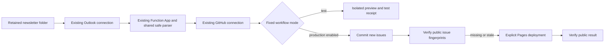

# Newsletter publishing with the existing Azure resources

Prof. Kornhauser continues sending to **smartdrivingcars@princeton.edu**. The supported setup reuses the authorized Outlook and GitHub connections in **YOUR_AZURE_RESOURCE_GROUP**, subscription **YOUR_AZURE_SUBSCRIPTION_ID**, in Canada Central. It does not require a new Entra app, app-only Graph token, or Exchange Application RBAC grant.

The receiving mailbox is **orfe-lists@princeton.edu**. Production reads **SmartDrivingCars Newsletters for Processing**. An isolated, manually triggered test workflow reads **SDC Testing**, builds a preview, and produces an operator receipt without committing newsletter content or deploying Pages.

The latest supplied issue remains [14.16 Bad Media](https://smartdrivingcar.com/14.16-badMedia-10.22.26/). The optional [app-only Graph alternative](app-only-newsletter-setup.md) is retained for organizations that later prefer a dedicated mailbox-scoped application. It is not a prerequisite for this setup.

## Existing resources and ownership

| Resource | Existing name | Treatment |
| --- | --- | --- |
| Outlook API connection | `orfe-dept-azure-sdc-o365` | Reference existing authorization |
| GitHub API connection | `orfe-dept-azure-sdc-github` | Reference existing authorization |
| Function App | `orfe-dept-azure-sdc-func` | Add batch endpoint; retain old endpoint and hosting |
| Function hosting plan | `CanadaCentralLinuxDynamicPlan` | Preserve Linux Consumption Y1 |
| Function storage | `stsdcnewsletter0xms` | Preserve existing account and data |
| Application Insights | `orfe-dept-azure-sdc-func` | Preserve existing telemetry resource |
| Original arrival Logic App | `orfe-dept-azure-sdc-logic` | Preserve until production reconciliation is accepted |
| Test Logic App | `orfe-dept-azure-sdc-test` | Manage with Bicep; reads only the configured test folder |
| Production reconciler | `orfe-dept-azure-sdc-reconcile` | Manage with Bicep; initially disabled |

The existing Office 365 Outlook connector uses sign-in authorization. A `Connected` status is a prerequisite; the live folder probe verifies actual access. If the existing grant is revoked, reauthorize the connection through Azure's API connection screen under Princeton's consent policy. Do not replace it with a new app-only identity as a troubleshooting shortcut. [Microsoft documents the connector sign-in process](https://learn.microsoft.com/en-us/azure/connectors/connectors-create-api-office365-outlook).

The connector's existing delegated permissions may be broader than read-only. This workflow uses only folder listing and message retrieval; it never sends, moves, deletes, or marks mail read. Mailbox transport and Listserv posting restrictions remain the sender-authentication boundary. The parser additionally requires the configured author, list recipient, and newsletter subject; supplied List-Help headers are validated when the connector provides them. The connector does not consistently expose RFC headers, so they are not assumed to be available. Rejected messages are counted in operator receipts. Production can still publish valid messages, but any rejection makes the final health result fail for operator review.

## Reproducible infrastructure and deployment

`azure/connector/main.bicep` is the normal adoption template. It declares the existing connections and Function App as `existing`, adds the selected workflow, and merges three publishing-policy settings into a private snapshot of existing Function settings. The deployment tool retrieves that snapshot and the Function key into a mode-0600 temporary parameter file, supplies them as secure ARM parameters, and removes the file afterward. It never prints or commits those values. Bicep resource references reuse infrastructure rather than recreating it. [Microsoft's existing-resource reference](https://learn.microsoft.com/en-us/azure/azure-resource-manager/bicep/existing-resource) describes this model.

`existing-resources.json` records the non-secret resource inventory; `recovery.parameters.example.json` provides foundation parameters. `test.json` and `production.json` pin the subscription, resource group, names, region, mailbox, folder, author, and list address. They contain no credentials. For an opaque folder ID or deployment-specific override, copy one to a `*.local.json` file, which Git ignores. Folder resolution handles folders at the mailbox root or directly under Inbox. Deeper folders can use their explicit folder ID. Folder IDs and callback URLs stay out of public receipts.

`azure/connector/foundation.bicep` describes recovery infrastructure: storage, Linux Consumption plan, Python 3.11 Function App, telemetry, and connection shells. Use it only for disaster recovery or a separate deployment, not normal updates of this resource group. Connection consent is stateful and cannot be reconstructed from source code; after a full rebuild, browser authorization is still required. The recovery template uses HTTPS, TLS 1.2, disabled public blob access, and a dedicated logging workspace. Normal adoption preserves the existing storage/telemetry resources. Deploying Function code also enforces HTTPS-only on the existing Function App.

`Dockerfile.functions` packages the Function runtime using an immutable Microsoft image digest. `Dockerfile.pipeline` packages the same Python test surface. ZIP deployment uses the existing Consumption service and the locked `azure/functions/requirements.txt`; it does not migrate the hosting plan to containers. The deployment package includes both old and new endpoints and the shared safe renderer.

## Processing and publication



Production reconciles every 15 minutes using `Get emails V3`, including read messages. It searches the configured folder over a 90-day window and defaults to a 100-message limit. Reaching the limit fails visibly instead of silently dropping older messages; narrow the lookback or increase the bound when recovering a large backlog. Search queries avoid the connector's documented first-250-message limitation for simple filters. [The Outlook connector reference](https://learn.microsoft.com/en-us/connectors/office365/#get-emails-v3) documents these controls.

The Function validates and sanitizes each candidate. It preserves headings, emphasis, paragraphs, lists, and tables; removes active HTML, recipient tickets, and Outlook tracking wrappers; and escapes template syntax before Jekyll evaluates it. It does not fetch remote images or CID attachments. The renderer is tested for stability across the Function-to-GitHub boundary.

GitHub dispatch payloads have a bounded size. A batch includes as many oldest pending issues as fit; the receipt reports `remaining`, and later sweeps drain the backlog after commits appear in the repository. A single oversize issue fails for a reviewed local import. Every retained known issue is included in the public-verification manifest. Changed content for an automatically managed identifier requires manual review; curated legacy/manual imports remain authoritative.

GitHub independently validates the batch. Production requires repository variable `NEWSLETTER_CONNECTOR_ENABLED=true`. New content is committed with a normal push, and the reusable Pages workflow is invoked explicitly when public verification shows an issue missing or stale. A failed deployment is recoverable on the next sweep even when the source file has already been committed. No mailbox cursor or read flag advances.

The original defects were an unsplit `value` array in the arrival trigger and relying on bot commits to trigger another workflow. The old template's `splitOn` correction and explicit receiver deployment remain available, but reconciliation is the preferred recovery mechanism. Azure's dispatch receipt means GitHub accepted the event; the final GitHub receipt and public verification establish publication success.

## First run using SDC Testing

Prerequisites are your existing Azure CLI login, GitHub CLI login, local project `.venv`, and access to this resource group. No new mailbox grant is part of this path.

1. Copy one real newsletter from the last 90 days into **SDC Testing** in **orfe-lists@princeton.edu**, preserving its author, recipient, subject, date, and HTML body. Copy the existing delivery rather than forwarding it. Do not email the subscriber list to test the system.
2. Inspect the proposed changes:

   ```zsh
   ./azure/connector/deploy.zsh --dry-run
   .venv/bin/python scripts/azure_connector_admin.py plan --mode test
   ```

3. Deploy and enable the test workflow and shared Function adapter:

   ```zsh
   ./azure/connector/deploy.zsh --enable
   ```

   Deployment preserves the authorized connections, deploys the workflow disabled while code is prepared, publishes the Function ZIP, and smoke-tests the deployed parser with a synthetic **test-mode** request. That smoke request sends no mail and dispatches no GitHub event. The workflow is enabled only after the Function responds correctly.

4. Run the real mailbox test:

   ```zsh
   ./azure/connector/test.zsh
   .venv/bin/python scripts/azure_connector_admin.py status --mode test
   ```

   Tests are on demand through a private callback, not a recurring schedule. The helper obtains and invokes that callback without printing its signed URL.

5. Open **Receive Outlook connector batch** in GitHub Actions. The test job's summary shows `correlation_id`, message counts, validation counts, and the preview result. Match that correlation ID to Azure's **Batch_receipt** action. Require the preview-build success message and at least one validated newsletter. An empty folder or zero accepted newsletters fails the full test explicitly.

6. Repeat the test to confirm deterministic behavior. Confirm no newsletter source commit or Pages deployment was created by either test run.

The GitHub test job has read-only repository permissions, no Pages permission, no commit step, no deployment step, and no content artifact upload. Test previews live only in the runner's temporary directory. A forged test payload cannot select the production receiver. Operator receipts contain counts and correlation IDs, not email content or addresses.

For a folder-access-only diagnosis before code deployment:

```zsh
./azure/connector/deploy.zsh --probe --enable
./azure/connector/test.zsh
.venv/bin/python scripts/azure_connector_admin.py status --mode test
```

Probe mode reports folder resolution and message count and sends nothing to GitHub. Deploy normally afterward to exercise parsing, dispatch, and preview construction.

## Production cutover after acceptance

Keep `NEWSLETTER_PIPELINE_ENABLED=false` for the optional app-only reconciler and `NEWSLETTER_LEGACY_ENABLED=false` for the original dispatch receiver. Set the new production gate and deploy only after the test receipts pass:

```zsh
gh variable set NEWSLETTER_CONNECTOR_ENABLED --repo PrincetonUniversity/smartdrivingcar --body true
./azure/connector/deploy.zsh --mode production --enable --skip-code
./azure/connector/test.zsh --mode production
.venv/bin/python scripts/azure_connector_admin.py status --mode production
```

`--skip-code` reuses the tested Function package and checks its smoke response before enabling the production reconciler. Inspect the production GitHub run, confirm the public issue and archive links, and repeat a sweep to verify duplicate handling. Then disable the old arrival Logic App `orfe-dept-azure-sdc-logic` through Azure. Leave the two API connections authorized: the new reconciler still uses them.

If a test folder is no longer needed, `./azure/connector/teardown.zsh --mode test` disables only its workflow. It does not delete messages, connections, the Function App, storage, or the resource group. All deployment, update, test, and teardown wrappers support `--dry-run` and stop at errors.

## Optional monitoring

Store a production Healthchecks UUID ping URL in repository secret `HEALTHCHECKS_PING_URL`. Configure a 15-minute period with a generous grace time, such as 60 minutes. The GitHub production observer sends success only after public verification, or `/fail` on a processing/deployment error. Absence of success detects failures before dispatch, revoked connector authorization, or a stopped Azure scheduler. Test receipts never keep the production check green.

For an immediate upstream Azure failure signal, provide the same URL in exported `SDC_HEALTHCHECKS_PING_URL` when deploying the **production** template. It becomes a secure Logic App parameter and is hidden from action inputs/outputs. Upstream failure reporting cannot turn a failed publishing run into a success. [Healthchecks failure signaling](https://healthchecks.io/docs/signaling_failures/) defines `/fail` behavior.

For optional Resend status email, verify a sending domain and set repository secrets `RESEND_API_KEY`, `RESEND_FROM`, and `RESEND_TO`, all together. Use a sending-only key and a single operator recipient. The production observer reports new-publication success, repaired deployments, and failures; `RESEND_NOTIFY_IDLE=true` enables routine poll status. Notifications contain workflow links and counts, never newsletter bodies. L-Soft continues to distribute the newsletter itself. Use **Test optional newsletter monitors** to verify delivery before relying on alerts. [Resend's sending API](https://resend.com/docs/api-reference/emails/send-email) supports these operational messages.

## Recovery and maintenance

| Failure surface | Meaning and response |
| --- | --- |
| Folder probe fails | Check connection authorization, exact folder name, mailbox, nesting, or explicit folder ID. No message was changed. |
| Function returns invalid batch | Inspect the retained message privately; check author/list/subject/HTML and size limits. |
| Connector message count reaches limit | Increase `messageLimit` or reduce `lookbackDays`; no cursor was advanced. |
| Batch reports remaining issues | Later scheduled sweeps drain the bounded backlog; inspect that the count decreases. |
| GitHub inventory lookup fails | Check GitHub availability/rate limiting; the next sweep retries. No source mail is discarded. |
| Azure dispatch accepted but no GitHub job | Check GitHub connector repository access and the production gate; a dispatch acknowledgment is not publication success. |
| GitHub preview has zero validated issues | Put a copied real delivery in SDC Testing and inspect policy matching. |
| Same identifier has changed content | Compare the versions and explicitly review/reparse that one issue. |
| Commit exists but web verification fails | Re-run reconciliation; it invokes a deployment repair. |
| Healthchecks overdue | Check Azure run history, connection authorization, GitHub receiver status, and provider availability. |

Use `./azure/connector/update.zsh` for repeatable updates; it defaults to test and disabled until `--enable` is supplied. To stop production, set `NEWSLETTER_CONNECTOR_ENABLED=false` and run `./azure/connector/teardown.zsh --mode production`. Already accepted work may finish; inspect outstanding workflow runs. Both steps are reversible, and neither deletes mail or resources.

For reviewed local imports and reparsing, use `scripts/publish_newsletter.py --eml FILE --dry-run`, inspect the result, then create or explicitly replace only the intended issue source. Commit generated newsletter/archive pages, never raw MIME input, credentials, private deployment parameters, callback URLs, or Function ZIPs.

## Verification and follow-up work

`docker-compose run --build --rm tests` runs verbose unit tests, lint, format, and type checks without network access. CI also compiles both Bicep templates with pinned Bicep 0.43.8. Tests model connector messages, dispatch size limits, conflicts, sender gates, Function HTTP validation, test/production separation, private packaging, and cloud-free deployment dry runs. Live probe, parser smoke, GitHub preview, repeated delivery, and production verification provide separate observable acceptance surfaces.

The next optional enhancement is validated extraction of CID image attachments into local assets, with size/type limits and metadata removal. It is independent of publishing reliability. AI rewriting is excluded from unattended publication so the professor's wording remains authoritative.

## Verified deployment on October 29 2026

The existing-connection folder probe resolved SDC Testing and read one copied message. The full mailbox-to-Function-to-GitHub test then scanned one message, accepted one, rejected none, and built the isolated preview successfully. [The successful test run](https://github.com/PrincetonUniversity/smartdrivingcar/actions/runs/40902473326) performed no newsletter commit or Pages deployment. Its Azure correlation ID is `06aad212-ab19-4987-a232-f61033ad3d87`.

This test exposed and fixed a cleanup defect: compact Outlook HTML could place the gateway warning or a Listserv macro on the same source line as the entire article. Line-based cleanup erased the article. Cleanup now removes the bounded warning DOM block and individual macro text instead. Copying mail with Outlook is sufficient; opening or marking it read is not part of processing.

## Authorial fidelity and web presentation

Renderer version 2 preserves the professor's wording, punctuation, quotations, cross-issue links, bold/italic emphasis, and explicit emphasis resets. Word's red and blue text is mapped to a small set of controlled CSS classes. Large linked article titles become semantic headings; short centered masthead paragraphs receive compact spacing. Arbitrary email CSS is never published. The site keeps its existing logo, navigation, Open Sans typography, blue link palette, and white reading surface. Red source emphasis remains visible in a readable darker red.

The latest issue was reparsed from the original EML. A comparison against the previously published edition found no removed non-whitespace prose characters. Source header/cross-reference text that old cleanup had erased was restored, including “It's been a while.” Desktop and 390-pixel phone layouts were checked in a real browser with no horizontal page overflow. Tests cover source text preservation, heading recognition, emphasis, inline resets, safe image alternatives, empty linked-image fallbacks, and repeated rendering stability.

Images still use alternative text or a visible destination link; attached images and tracking pixels are not fetched. Malformed date-style self-links are unwrapped while their date text remains. Image attachment extraction remains the separate, size/type-validated enhancement described above.

## Archive presentation migration

All 366 newsletter sources were traversed. The 365 historical Markdown entries now use the current issue's reading typography, blue article headings, paragraph rhythm, and responsive content width. The current HTML email edition remains the reference. Long issues have a keyboard-accessible, collapsible contents list. Reader titles remove filename separators and redundant date suffixes while retaining the original title, date, display name, and permalink metadata.

The migration normalizes 313,864 lines of inherited email indentation, which previously turned ordinary prose into narrow columns or monospace code blocks. It unwraps 468 Outlook link wrappers without fetching their destinations. Explicit `Hmmmm…` editorial markers separate commentary from quoted reporting and use the current issue's controlled red accent; continuation paragraphs remain commentary until the author signs off or a new article begins. The older Markdown no longer contains the original Word color information, so this is a structural cue rather than a reconstruction of lost formatting. Existing emphasis, paragraphs, lists, links, and the archive's existing poster image are retained. Decorative asterisk separators become horizontal rules.

Every transformed issue stores a fingerprint of its rendered prose. Tests check every entry separately. The migration verifies that formatting changes retain the prose fingerprint and link order; the compiled-site check verifies the fingerprint again after Jekyll rendering. Existing heading anchors are preserved from the previous build. Two legacy permalinks containing consecutive dots need output-path repair because Jekyll otherwise splits their directories; the deployment now repairs these paths before checking internal links and uploading Pages.

Run the migration against a previously built site, with the default read-only pass first:

```zsh
.venv/bin/python scripts/restyle_archive.py --reference-site build/presentation-before
.venv/bin/python scripts/restyle_archive.py --reference-site build/presentation-before --write
docker-compose run --build --rm tests
```

After a Jekyll build, validate every compiled issue and preserve its canonical route:

```zsh
.venv/bin/python scripts/restyle_archive.py --check-site _site --repair-routes
```

The formatter is idempotent: running it again leaves the migrated entries unchanged. `build/` is excluded from Jekyll output and rejected by the private-file deployment guard. Temporary comparison builds, screenshots, raw mail, and test reports remain outside the committed site sources.

Acceptance covered all 366 compiled issues and all 366 browser pages at both 1440-pixel desktop and 390-pixel phone widths. Every historical issue had a measurable typography or section-structure change, and none overflowed the page horizontally. Original front-matter fields and previously published heading anchors were retained. The 628-test container suite includes a separate presentation and prose-integrity check for each issue.
